# tmux-band

**Conduct your band from one place.**

One terminal window for every Claude Code session you have running. A sidebar shows who is working, who is done, and who is waiting on you.



## Install

```sh
curl -fsSL https://raw.githubusercontent.com/suavesav/tmux-band/main/get.sh | sh
```

or with Homebrew:

```sh
brew install suavesav/tap/tmux-band && band install
```

Needs tmux 3.3+ and Node 18+. macOS and Linux.

## Play

```sh
band                          # open the band window (starts Claude here the first time)
band new                      # another Claude session, in this folder; it shows up in the sidebar
band new -n "fix login" -C ~/code/web-app -- claude --model opus
band new -t work -- CLAUDE_CONFIG_DIR=~/.claude-work claude
```

Then use the mouse:

| Click | What happens |
| --- | --- |
| a row | jump to that session |
| drag a row | reorder the list |
| drag the sidebar's edge | make it wider or narrower (20 to 60 columns) |
| `✕` | close it (asks first unless it is done) |
| `⤢` | expand the list into a table with every detail |
| `+ new session` | a plain shell in the same folder, for any CLI you like |

Close the terminal window whenever you want. The sessions keep running; `band` brings them back.

## What the sidebar tells you

- **● orange**: needs input. A permission prompt, a plan to approve, a question.
- **◌ blue**: working.
- **✓ green**: done, and you have not looked yet. It turns grey once you do.
- How long each session has been in that state.
- The repo and branch it is in.
- The pull requests it mentions, with CI: `#412 ✓`, `✗`, `◌`, `merged` (needs `gh`).

## When tmux dies

A crash or a reboot takes every session with it. Run `band` again and it offers to reopen the Claude sessions from the last 24 hours, each resumed with `claude --resume` in its folder. Sessions you closed yourself stay closed.

## How it works

- A tmux server of its own, on its own socket. Your `~/.tmux.conf` and your other tmux sessions are not touched.
- Claude Code hooks write each session's state onto its tmux window. The installer adds them to `~/.claude/settings.json` (and any `~/.claude-*` account folders), with a backup beside each file it changes. They do nothing outside the band window.
- The sidebar is one small Node script per window. No daemon, no dependencies.

`band doctor` checks the setup. On macOS with iTerm2, `band attach` raises the band window from anywhere, so it makes a good global hotkey.

To remove it: `band uninstall` takes the hooks and links out, then `rm -rf ~/.local/share/band`.

## Build your own

The whole thing is specified in one file: **[docs/spec.html](https://suavesav.github.io/tmux-band/spec.html)**. Hand it to a coding agent and it can rebuild tmux-band from scratch, or adapt it to another terminal or another CLI. This implementation was built that way, and it is checked against the test cases in the spec.

## Develop

```sh
node --test                   # unit tests
bash test/smoke.sh            # end to end, on a throwaway tmux server
node scripts/build-spec.mjs   # regenerate docs/spec.html and test/vectors.json
```

MIT
